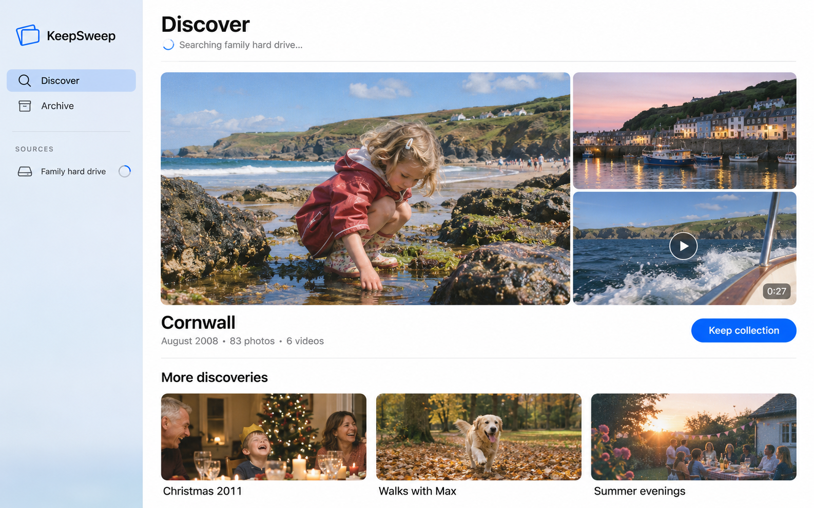

# Keevoro: Planning

Keevoro finds every photo and video on a pile of old drives, gathers the keepers into one tidy library, and archives it to S3-compatible storage with a browsable index. It runs on Windows and macOS and is built for people who are not technical.

The full product thinking (business model, security levels, index rationale) lives in the planning doc: [Keevoro: Planning](https://claude.ai/artifact/X9Gx1eYMVmbPABA2u9od7y). This file is the engineering summary that the code follows.

## Who it is for

Someone with a drawer of old laptops, USB sticks and backup disks who knows the family photos are "in there somewhere". They should never see a hash, a bucket, an endpoint or an EXIF tag.

The promise, in their words:

- "Plug in my old drives and it finds all my photos and videos."
- "I keep what I want. It ignores the junk and the duplicates."
- "Everything ends up in one place, safely backed up."
- "It never touches or deletes anything on my old drives."

## Design direction: very Apple

The reference mockup is [docs/design/discover-mockup.png](docs/design/discover-mockup.png).

What that means in practice:

- **Moments, not folders.** The main screen is **Discover**: large photos grouped into collections ("Cornwall, August 2008, 83 photos, 6 videos") with one primary action, **Keep collection**. The folder tree exists but sits behind a quiet "Show folders" option.
- **Scanning feels alive.** Collections appear while the drive is still being searched ("Searching family hard drive..."). Nobody waits for a progress bar to finish before seeing their photos.
- **Sources are named like people name things.** "Family hard drive", "Dad's old Dell".
- **One decision per screen**, written in plain words. Safe defaults everywhere: junk and duplicates are already handled, and nothing is copied until the user says so.
- **Generous space, big imagery, system fonts, soft materials.** No dense tables, no badges, no jargon. Advanced settings live behind one clearly labelled door.

This is why the UI plan is Tauri 2 with a web front end: big responsive image grids, smooth transitions and a polished look are far quicker to reach there than with native widget toolkits.

## Collections

A collection is the unit the user sees and keeps. The engine builds them in `keevoro-core::collections`:

- **Named albums** come from the user's own folders. `Pictures\Holidays\Cornwall` becomes "Cornwall" with "Holidays" as a quiet subtitle.
- **Moments** group unnamed files by date. A gap of more than 3 days starts a new moment, titled by its date range ("March 2012").
- **Undated** holds files with no believable date and no album.
- **The cover** is the largest photo for now. Later it will be the sharpest, best-exposed photo, chosen on-device.
- **Later:** smarter moment titles ("Walks with Max", "Summer evenings") from on-device image labelling and place names. This must never upload photos to a third party.

## Respecting the user's folders

People have often organised their photos already. Keevoro keeps that work:

- The meaningful part of each folder path becomes a nested album.
- Noise is trimmed from the path: user profile paths, `My Pictures`, `DCIM`, camera folders like `100CANON`, `New Folder (2)`, and "Copy of" or "Backup of C" wrappers.
- The same folder found on two drives becomes one album.
- Folder names give date hints ("2009-07 Spain", "July 2009"). Folders that are only a date (`2009_07_14`) are hints, not albums.

## Hard safety rules

These are requirements, not aims. Each one has tests.

1. **Source drives are read-only.** Keevoro never writes, renames, moves or deletes anything on a source.
2. **Copy, then verify.** A file counts as collected only when a re-read hash matches.
3. **Verify remote copies too**, with server checksums where supported and BLAKE3 stored on each object.
4. **Never overwrite originals.** Library and bucket are add-only (`create_only` puts).
5. **Be gentle with dying drives.** Timeouts, a retry list, and a rescue mode that copies first and analyses later.
6. **Check space before copying.**
7. **Everything resumes.** Every step is a persistent job.
8. **Nothing leaves the machine without consent.** No telemetry by default.

## Architecture

A Rust workspace of small crates. The core has no I/O, and storage sits behind narrow traits.

| Crate | Status | Responsibility |
| --- | --- | --- |
| `keevoro-core` | Built | Domain rules: media kinds, dates, folder hints, skip rules, junk hints, photo library layouts, collections. No I/O. |
| `keevoro-scan` | Built | Walk a source, detect media by content, read EXIF and video dates and pixel sizes, hash with BLAKE3. Read-only. |
| `keevoro-storage` | Built | Storage traits, errors, keys, and the shared conformance suite. |
| `keevoro-storage-folder` | Built | Local folder, external drive or NAS target. Reference provider. |
| `keevoro-cli` | Built | The `keevoro` command: every operation in the API's register, on the same named backups as the app, with `--json` and exit codes for scripts. |
| `keevoro-update` | Built | `keevoro update`: finds the latest GitHub release, checks the download against its checksum file and swaps the program (`ureq`, `sha2`, `self-replace`). |
| `xtask` | Built | Release tooling: changelog rules, version choice, release cut. Run with `cargo xtask`. |
| `keevoro-catalog` | Built | SQLite catalog (`rusqlite`, bundled): sources, what was found, keep choices. The job queue arrives with `keevoro-collect`. |
| `keevoro-collect` | Built | Agrees each kept file's place in a backup and makes its previews (`fs4` for the free-space check). Rendering itself is in `keevoro-media`. |
| `keevoro-media` | Part built | Thumbnails and display copies as WebP (`image`, `webp`), blurhash, rotation baked in, no metadata carried over. Video posters from the computer's own decoder, or the computer's own ffmpeg as a separate program. The MP4 conversion once here was removed with the library model; git history has it. HEIC and RAW previews to come. |
| `keevoro-publish` | Built | The upload engine: write-once originals, resumable multipart, retries. Depends only on the storage traits. |
| `keevoro-storage-s3` | Built | One S3-compatible adapter (`aws-sdk-s3`) with presets for R2, AWS S3, Google Cloud Storage and any custom endpoint. Checked against MinIO in CI. B2 and Wasabi presets to come. |
| `keevoro-index` | Built | v2 index writer, its JSON Schema (`schemars`), and v1 gallery.json export. |
| `keevoro-platform` | Planned | Drive events, volume ids, keychain, per-OS differences. |
| `keevoro-engine` | Built | What Keevoro does as plain function calls: scan into a backup, the Discover view, keep or skip, previews, backing up, and Keevoro's notes kept at each destination (a gzip file of JSON lines, with `flate2`, already in the tree through the image crates). `keevoro-api` sits on it. |
| `keevoro-api` | Built | Every operation Keevoro offers, listed once in a register, for the app, the command line and an AI agent to share, with each request's JSON Schema (`schemars`) and the rules an agent is held to. Reports of a problem or an idea go to Keevoro's maker over `ureq`, as the updater's do, through the proxy Windows is set to use (read with `winreg`), or through the app's window when Keevoro cannot reach the service itself. The app, the command line and the MCP server each have a parity test against it. |
| `keevoro-mcp` | Built | `keevoro mcp`: a Model Context Protocol server over standard input and output, one tool per operation offered to agents (`rmcp`, the official Rust SDK, with only its server and stdio transport; `tokio`). |
| `keevoro-app` (`src-tauri`) | Part built | Tauri 2 desktop shell: a thin layer of commands over the engine. Screens are in `ui/` (React, Vite, TypeScript). Its icon by the clock uses Tauri's own `tray-icon` feature; `tauri-plugin-single-instance` keeps one Keevoro window program running, `tauri-plugin-autostart` starts it with the computer when the person asks, and `tauri-plugin-notification` tells the person how a backup by itself went (all official Tauri plugins). |

### Storage plug-ins

S3-compatible storage is the priority. The engine depends only on these traits from `keevoro-storage`:

- `ObjectStore`: capabilities, connection check, head, get, put, list (paged), delete.
- `MultipartStore`: start, put part, complete, abort, list parts. The engine persists upload ids and part receipts so big uploads resume after a crash.
- `Capabilities` tells the engine what a provider supports (multipart limits, conditional create, server checksums, custom metadata) instead of it assuming.

Every provider must pass `keevoro_storage::conformance::run_all`. The suite writes under a unique prefix and cleans up, so it is safe against a real bucket.

### Index

Every upload writes a v2 JSON index under an unguessable name (`index/<128-bit random>.kvx`, served as JSON). Items are keyed by the first 16 hex characters of their BLAKE3 hash, albums nest, and private albums never appear in a public index. A v1 `gallery.json` is also exported so the current gallery site keeps working. The full schema is in the planning doc.

## Engineering principles

- SOLID, YAGNI, KISS. Crates are created when the work needs them, not before.
- TDD. At least 90% test coverage overall, at least 95% on copy, verify and storage code.
- `unsafe` is forbidden. `unwrap` and `expect` are linted outside tests.
- Pure rules live in `keevoro-core` so they can be tested exhaustively without touching disks.
- Clippy with `-D warnings` and `cargo fmt` must pass before any merge.
- GitHub is the only source control. CI runs on Windows, macOS and Linux.

## Decisions made

| Decision | Choice |
| --- | --- |
| Platforms | Windows and macOS. Linux builds but is not a v1 target. |
| Language | Rust |
| UI | Tauri 2 with a web front end, styled to the "very Apple" direction |
| Storage | Pluggable traits. S3-compatible first (R2 and AWS S3), plus local folder. |
| Folder handling | Keep the user's folders by default. Sort by date is an option. |
| Old videos | Opt-in automatic MP4 (H.264 and AAC) conversion in the first release |
| Index | Always written on upload, under an unguessable name |
| Hashing | BLAKE3. Item id is the first 16 hex characters. |
| Audience | Personal use first. Commercial options kept open. |

## Backups and destinations

People use Keevoro for separate jobs: family photos to a folder, holiday videos to cloud storage, perhaps a client's work somewhere else. A **backup** is one of those jobs. It has a name, its own sources, its own choices about what to keep and its own destination, and it is remembered, so the same job can be run again next month and only what is new is sent.

A **destination** is anywhere files can be sent: a folder (on this computer, another disk, a network drive) or storage that speaks S3 (Cloudflare R2, Amazon S3, Google Cloud Storage and others). They are the same kind of thing. A file's place (its folder and name) is agreed once and is the same in every destination, and files go straight from the source to the destination. There is no library on this computer that everything must pass through.

How it is built:

- Each backup has a home folder in the app's own data, holding its catalog and previews. The photos themselves are not copied there.
- `settings.json` lists the backups and which is open, read afresh each time so the app and the command line agree.
- Each destination holds a copy of Keevoro's notes about the backup, written after every backup, so it can be opened on a new computer and carry on without sending anything again. Its sources are connected again by the person; where they were on the old computer is history, never assumed.
- Sending is `check_and_place` (tell apart files that look alike, agree each file's place) and the originals, then `make_previews` and the previews, then the index, to each destination in turn (`send::everywhere`).

Still to do: a backup that only looks for videos, or only photos.

## Open questions

- Which encoder for MP4 conversion: bundled ffmpeg with x264 (GPL), or the OS encoders?
- Should keevoro publish straight into the existing gallery's bucket, moving the gallery site to the v2 index?
- How should private albums be protected: signed links, Cloudflare Access, or a separate bucket?
- Should encrypted backups move into the first release?
- HEIC and RAW in v1?
- Open source, open core, or closed?
