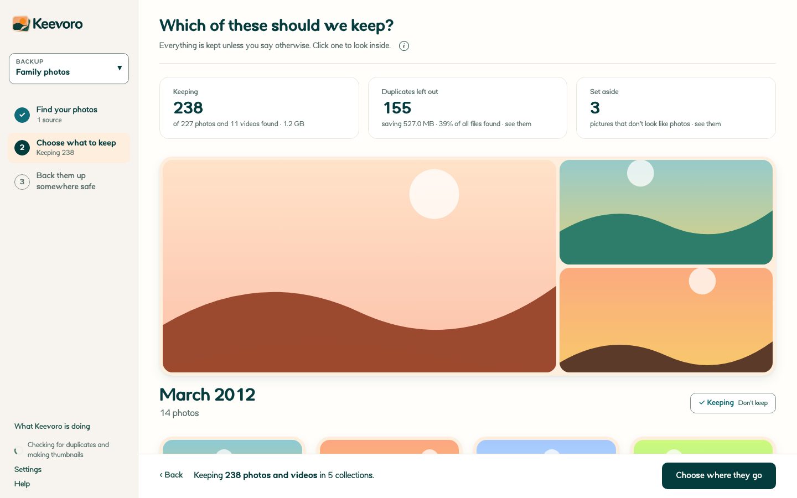
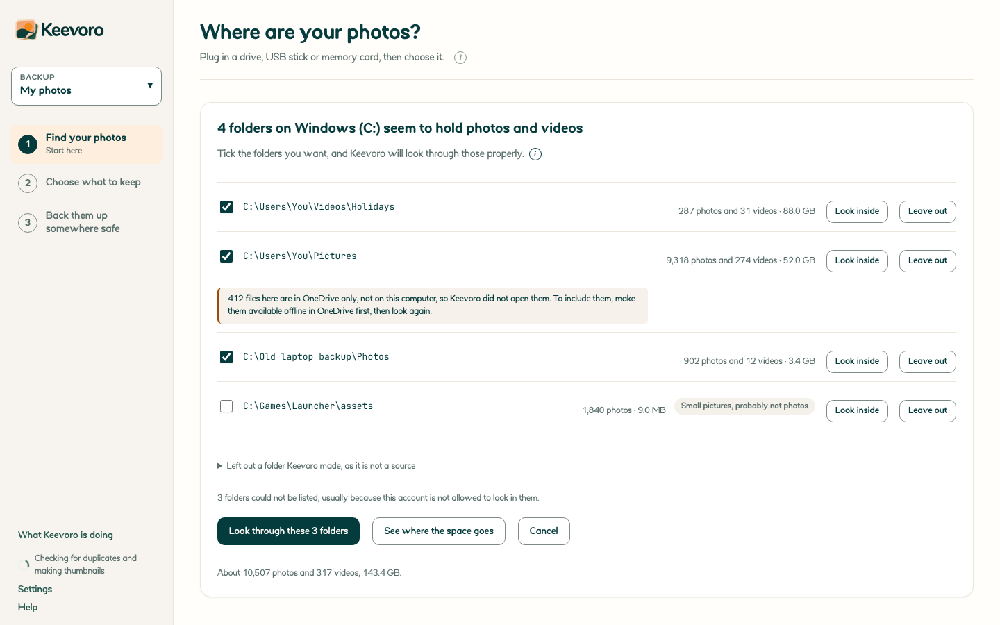
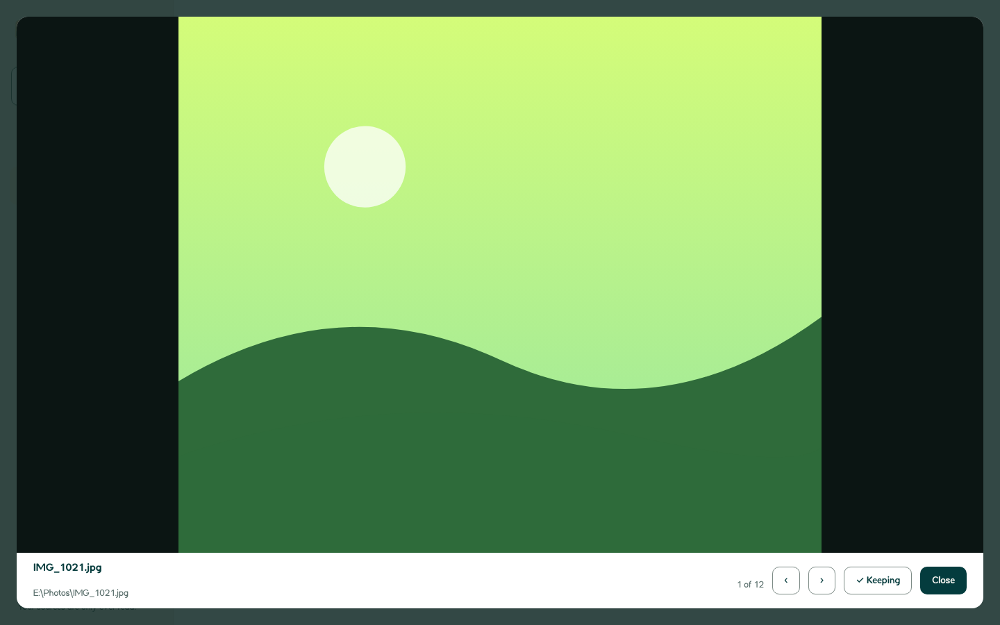
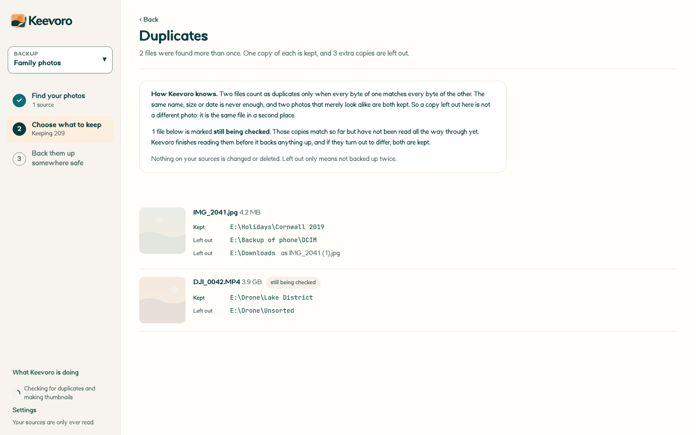
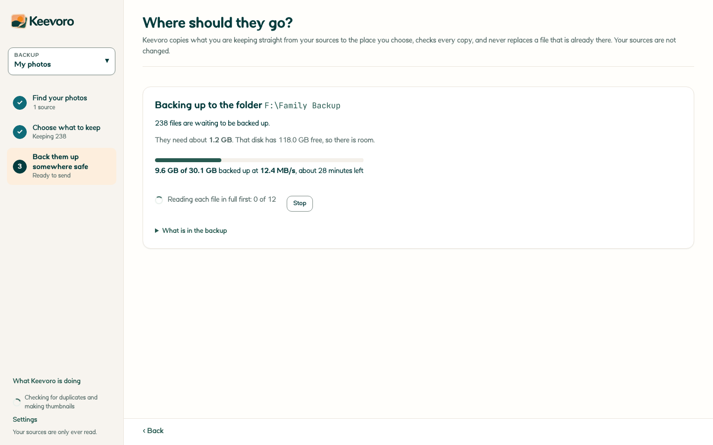
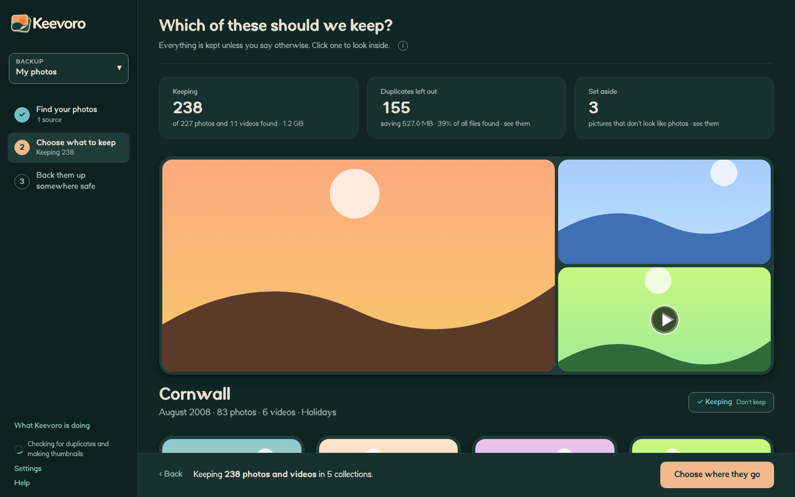

<p align="center">
  <picture>
    <source media="(prefers-color-scheme: dark)" srcset="design/keevoro-lockup-reversed.png">
    
  </picture>
</p>

<p align="center"><b>Keep things as they were.</b></p>

<p align="center">
  Find every photo and video on your drives, choose what to keep,<br>
  and back it up somewhere safe. Nothing on a source is ever changed.
</p>

<p align="center">
  <a href="https://github.com/markcastle/keevoro/releases/latest"></a>
  <a href="https://github.com/markcastle/keevoro/actions/workflows/ci.yml"></a>
  <a href="LICENSE.md"></a>
  
  
</p>

<p align="center">
  <a href="https://github.com/markcastle/keevoro/releases/latest/download/Keevoro-windows-x64-setup.exe"><b>⬇️ Download for Windows</b></a>
  &nbsp;·&nbsp;
  <a href="https://github.com/markcastle/keevoro/releases/download/v0.23.0/Keevoro-macos-universal.dmg"><b>⬇️ Download for Mac</b> (0.23.0)</a>
  &nbsp;·&nbsp;
  <a href="CHANGELOG.md">What’s new</a>
</p>



## 👋 What Keevoro is

Photos pile up in places nobody remembers: an old laptop, three USB sticks, a drone's memory card, a folder called "Backup of backup". Keevoro goes through them, finds the photos and videos, sets the junk aside, spots the exact duplicates, and backs up what you choose to a folder, another disk, or cloud storage of your own.

It is a desktop app for Windows and macOS, with a command-line tool that does the same things. It is written for people who have never heard of a checksum, and built by people who care a great deal about them.

Three words you will see:

- A **source** is anywhere Keevoro looks for photos: a drive, a USB stick, a memory card, a folder.
- A **backup** is a named job, such as "Family photos" or "Drone footage". Each remembers its own sources, choices and destination, so you can come back later and it sends only what is new.
- A **destination** is where a backup goes: a folder, an external or network drive, Cloudflare R2, Amazon S3, or anything else that speaks S3. A backup can have several, and a photo counts as safe only once it is at all of them.

## 🧭 How it works

One question at a time, in three steps.

### 1. 🔎 Find your photos

Pick a plugged-in drive by name, or any folder. Not sure where on a big disk the photos are? Keevoro can **find the folders that hold them first**: it reads only the list of what is in each folder, never opening a file, so it gets through hundreds of thousands of files in seconds. Tick the folders you want and it looks through those properly.



### 2. ✅ Choose what to keep

What was found is laid out as collections: your own folders where they mean something, and by date where they do not. Everything is kept unless you say otherwise. Open a collection to leave single photos out, hold down on one to see it large, and look over the duplicates before anything is sent.

| Look closely without changing the tick | See exactly which copy is kept |
| --- | --- |
|  |  |

### 3. 💾 Back them up somewhere safe

Choose a destination and press **Back up now**. Files go straight from the source to the destination, each one checked against the original. You see how much has gone, how fast, and roughly how long is left.



## 🛡️ Promises

These are rules the code is built around and automated tests guard, not hopes.

- **Your sources are only ever read.** Keevoro never edits, moves, renames or deletes anything on a source. Removing a source from a backup only takes it off a list.
- **A copy counts only when it is proved exact.** Every file is fingerprinted from its full contents. An original written to a folder or drive is read back and compared with that fingerprint before it is called safe, and one that does not match is thrown away and said so. A file of the same name already there is fingerprinted too, and counted only if it is the same file. An original sent to Cloudflare R2 or Amazon S3 travels over an encrypted, error-checked connection, and "Check they all arrived" confirms each one is there and the right size.
- **No original in a backup is ever replaced or removed.** Originals are written once. Two different photos called `IMG_0001.jpg` both survive. Only what Keevoro makes itself, the previews and the list of contents, is ever rewritten.
- **Duplicates are exact, never guesses.** Two files are the same only when every byte matches. Same name, size or date is never enough, and photos that merely look alike are both kept.
- **Nothing is hidden without saying so.** Pictures set aside as junk are listed with the reason and can be brought back. Files that could not be read are counted on screen and listed by name in the log, and files that could not be backed up are named when the backup ends.
- **You do not need Keevoro to get your photos back.** A backup is ordinary files in ordinary folders, with a plain note inside explaining them.
- **Stopping is safe.** Stop, pause, unplug the drive or lose the connection, and it carries on from where it was.

## ✨ What it can do

- 📂 **Sources:** drives, USB sticks, memory cards, folders, network shares, the folders OneDrive, Dropbox, Google Drive and iCloud Drive keep on your computer, offered by name, and cloud storage (Cloudflare R2, Amazon S3 or anything S3-compatible), only ever read, with what reading it out would cost said first. Several per backup, with duplicates across all of them counted once.
- ⚡ **Quick survey:** find the folders with photos on a whole disk in seconds, opening no file.
- 🖼️ **Formats:** JPEG, PNG, HEIC, TIFF, WebP, camera raw (DNG, CR2, CR3, NEF, ARW and more), and MP4, MOV, AVI, MTS and other video. Add any other ending your camera uses, or switch one off, in Settings, Advanced (or `keevoro kinds`); a kind Keevoro cannot open is still backed up exactly.
- 🎵 **Other files, if you want them:** add an ending as "other files" (music, documents, project files) and Keevoro carries them along, backed up and checked exactly like your photos, listed by the folders they came from. It never shows them or groups them by date, and nothing of the sort is taken until you ask.
- 🧹 **Tidying:** app icons, tiny images and leftovers are set aside with a reason. Per source, you can include or leave out whole kinds of file.
- 🗂️ **Collections:** named after your own folders, or by date, with dates read from the camera data, the file name or the folder.
- 👯 **Duplicates:** found by full-content fingerprint, with a screen showing which copy is kept and which are left out.
- ☁️ **Destinations:** a folder or drive, Cloudflare R2, Amazon S3, MinIO or any S3-compatible storage. Keys live in the computer's own keychain.
- 🖥️ **Previews without extra software:** photos and video stills are decoded by the computer's own codecs on Windows and macOS.
- 📈 **A good guest on your computer:** a page saying what Keevoro is doing and why, with graphs of its own processor, disk, network and memory use, and one button to pause everything.
- 🔁 **Incremental:** open a backup again later and it sends only what is new.
- ⏰ **By itself, on a schedule:** every day, week or month at a time you choose, while Keevoro is open, or from your computer's own scheduler with `keevoro run --unattended`. Anything that needs your say waits for you, it waits while the computer is on battery or busy, and a backup drive that looks wiped or swapped is never filled again without you.
- 🔄 **Updates itself:** downloads the new version, checks it against the published checksums, and installs it.
- 🌗 **Light and dark:** or whatever your computer is set to.
- 🤖 **AI agents:** an AI app such as Claude can find your photos and back them up for you, through `keevoro mcp`. It may only look until you allow more, only in folders you name, and can never touch a source or delete a photo. See [docs/mcp.md](docs/mcp.md).



## ⬇️ Install

### The app

| Computer | Download |
| --- | --- |
| Windows 10 or 11 | [Keevoro-windows-x64-setup.exe](https://github.com/markcastle/keevoro/releases/latest/download/Keevoro-windows-x64-setup.exe) |
| Mac (Apple silicon or Intel) | [Keevoro-macos-universal.dmg](https://github.com/markcastle/keevoro/releases/download/v0.23.0/Keevoro-macos-universal.dmg) (version 0.23.0) |

While Keevoro is changing quickly, each release is built for Windows, and the Mac version is brought up to date at bigger milestones. That is why the Mac download is an earlier version.

The app is not yet signed with a paid certificate, so each system asks once whether you trust it.

- **Windows:** choose **More info**, then **Run anyway**.
- **Mac:** drag Keevoro to Applications, then right-click it and choose **Open** the first time.

After that it keeps itself up to date. When a newer release is out it says so across the top, and **Update now** does the rest.

### 💻 The command line

One line installs the `keevoro` command, and running it again updates it. Nothing needs an administrator password.

**Windows** (PowerShell):

```powershell
irm https://raw.githubusercontent.com/markcastle/keevoro/main/install.ps1 | iex
```

**macOS and Linux** (these too are built at milestones, so if the newest release has no file for your computer, the installer says so):

```sh
curl -fsSL https://raw.githubusercontent.com/markcastle/keevoro/main/install.sh | sh
```

It works on the same named backups as the app, so a backup started in one is there in the other. A first backup:

```sh
keevoro backups start "Family photos"
```

```sh
keevoro look "D:\Pictures"
```

```sh
keevoro destinations add --folder "E:\Family Backup"
```

```sh
keevoro run
```

The full walk-through, from a first look at a drive to a checked backup in a bucket, with every command, is in [docs/command-line.md](docs/command-line.md). Every command answers in JSON with `--json`, for scripts. `keevoro update` moves to the newest version.

## 📦 What a backup looks like

Open the destination and you will find ordinary files:

```text
What is in this backup.txt   a plain note explaining the folders below
originals/                   your photos and videos, untouched
  Holidays/Cornwall/...        one folder per collection
  By date/2008/2008-08/...     anything that did not belong to one
  Family Scans/Smith/...       a source you chose to keep in its own folders
  Other files/Mum/Documents/.. other files you asked for, in their own folders
renditions/                  smaller versions made for looking at
  thumb/ display/              small and screen-sized photos
  poster/ video/               a still of each video; playable copies of old ones
index/                       the list of what is here, for a gallery to read
```

The first time you set up a backup, Keevoro asks how to arrange it: **Arrange by date** (a folder for each year and month, keeping folders you have named) or **Keep my folders as they are** (the same folders and names as on your sources, starting with the source's own folder, which suits scans and folders you have already sorted). You can change it later, and for each source; it only changes where files go from then on, and nothing already backed up is ever moved.

A **rendition** is a version of a photo or video made for looking at, not for keeping. Everything outside `originals` can be made again from it, so it is safe to delete if you need the room. To get your photos back, copy the `originals` folder. That is all.

## 🚧 Where it stands

Keevoro is young and moving fast: there have been more than twenty releases, and [CHANGELOG.md](CHANGELOG.md) says what changed in each, in plain words. It is used for real backups, and you should still treat it as you would any new backup tool: try it on something you have another copy of first.

Honest limits today:

- A backup with several destinations sends to them one after another, not at the same time.
- The quick survey is offered for a whole drive, not yet for any folder.
- On a Mac, photos are decoded by Keevoro's own decoder, not the system's, so fewer formats get a preview.
- Mac and Linux versions are built at milestones, so they trail Windows.
- The app is not code-signed, hence the one-time trust prompt.
- Cloud backups are tested against MinIO, which speaks the same language as R2 and S3. Try a spare bucket first.
- An AI agent can use Keevoro only on the computer it runs on. Agents on other machines are for later.
- A backup on a schedule runs while the Keevoro window is open; running from an icon by the clock, with the window closed, and when a card is plugged in, is next.

What is planned is in [TASKS.md](TASKS.md).

## 🛠️ Build it yourself

You need [Rust](https://rustup.rs) and [Node.js](https://nodejs.org) 22 or newer.

```sh
npm install
```

```sh
npm run dev
```

To see the screens in an ordinary browser, with made-up photos and no drive needed:

```sh
npm run ui:dev
```

### How it is organised

| Crate | What it does |
| --- | --- |
| `keevoro-core` | The rules: what counts as a photo, how dates and album names are worked out, what to skip, what looks like junk, how collections are formed. No file access. |
| `keevoro-scan` | Looks through a drive or folder, and surveys a disk for where the photos are. Read-only. |
| `keevoro-collect` | Gives each file you kept its place in a backup, and makes the previews a gallery shows. |
| `keevoro-media` | Makes the thumbnails and viewing copies. |
| `keevoro-frame` | Asks the computer's own decoders for a photo or a video still. The one crate allowed `unsafe`. |
| `keevoro-publish` | Sends a backup to storage: resumable, and never replaces an original. |
| `keevoro-index` | Writes the index that describes a backup, and the JSON Schema other tools can check it against. |
| `keevoro-catalog` | Remembers what was found on each drive and what you chose to keep, in a small SQLite file in the backup's own folder. |
| `keevoro-storage` | The plug-in interface every storage provider implements, and the tests they must all pass. |
| `keevoro-storage-folder` | Stores a backup on a local disk, external drive or NAS, reading each copy back to prove it exact. |
| `keevoro-storage-s3` | Stores it in Cloudflare R2, Amazon S3 or anything else that speaks S3. |
| `keevoro-update` | Finds, checks and installs a newer version. |
| `keevoro-engine` | What Keevoro does, as plain function calls. |
| `keevoro-api` | Everything Keevoro can do, listed once, so the app, the command line and an AI agent can all do the same things. |
| `keevoro-cli` | The `keevoro` command: every operation in the API, on the same named backups as the app. |
| `keevoro-mcp` | `keevoro mcp`: a Model Context Protocol server, so an AI agent can do what the person allows, through the same API. |
| `src-tauri` and `ui` | The desktop app: a Tauri shell and its screens. |
| `xtask` | The project's own tooling: the changelog and cutting a release. |

## 🤝 Contributing

Changes are welcome. Start with these:

- [docs/developing.md](docs/developing.md): building, testing, how the pieces fit, cutting a release.
- [PLANNING.md](PLANNING.md): the design and the reasons behind it.
- [TASKS.md](TASKS.md): what is done and what is next.
- [AI_AGENT_PROMPT.md](AI_AGENT_PROMPT.md): the rules every change follows, whoever writes it. Tests first, plain words, and a changelog entry for anything a person would notice.

Before opening a pull request:

```sh
cargo fmt --all
```

```sh
cargo clippy --workspace --all-targets -- -D warnings
```

```sh
cargo test --workspace
```

```sh
npm run lint && npm run ui:test
```

## ⚖️ Licence

Keevoro's source is open to read, use, change and share under the [Functional Source License](LICENSE.md) (FSL-1.1-MIT). In plain words:

- ✅ Use it, at home or at work, for free.
- ✅ Read the code, change it, and share your changes.
- ✅ Each release becomes plain MIT two years after it comes out, for good.
- ❌ Until then, do not sell it or offer it as a product or service that competes with Keevoro.

The licence itself is what counts; this is only a summary. The Keevoro name and logo are not part of it: a fork needs its own name and icon, as [TRADEMARKS.md](TRADEMARKS.md) explains.

## 📖 The name

The name blends the sound of English *keep* with *voro*, an old Swedish word meaning "were". Together they capture why we save photos and videos in the first place: to remember people and places as they were.
